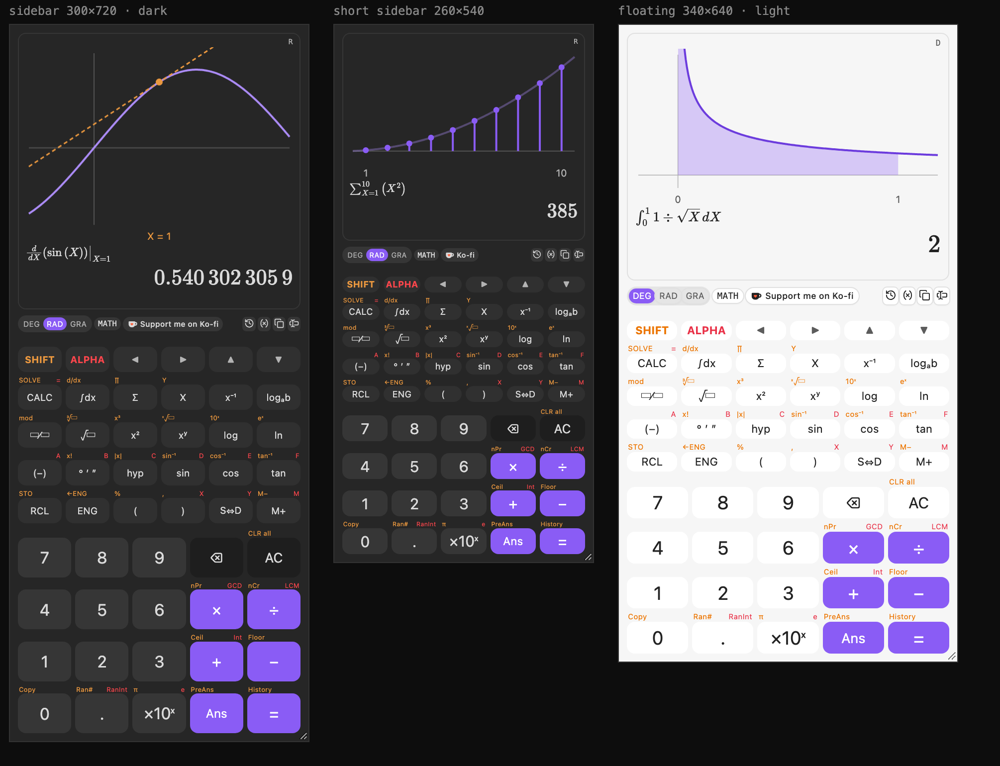
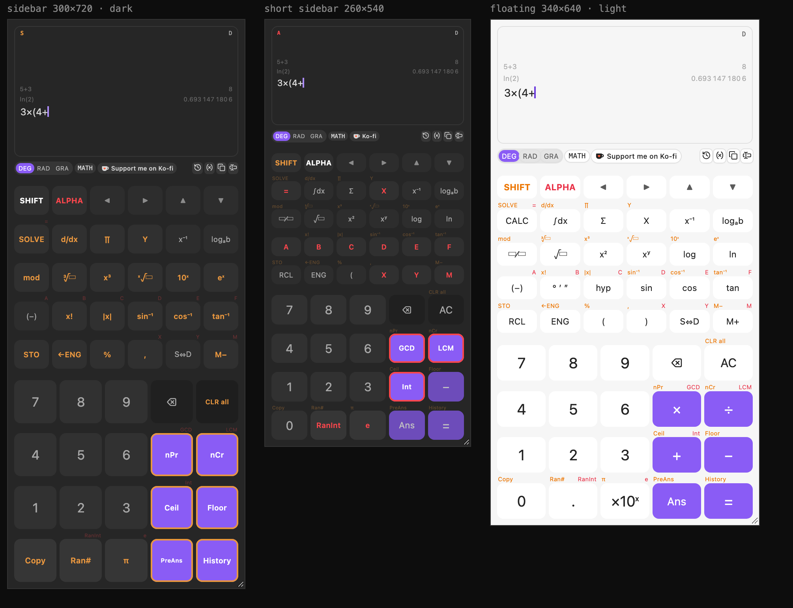

# Sidecalc

A scientific calculator for Obsidian that lives in your sidebar. It works like a hardware scientific calculator: SHIFT and ALPHA key layers, natural fractions and roots, calculus, and an equation solver. It also shows a graph of what you just calculated.



## Features

- **Expression entry.** Type the whole calculation, then press =. Missing closing brackets are added for you, and you can edit anywhere with ◀ ▶.
- **SHIFT and ALPHA layers.** Press SHIFT and every key's label changes to its second function; press ALPHA for the variables A–F, X, Y and M.
- **Exact answers.** Results show as fractions, roots and multiples of π (3/4, √2, 2π/3) in MATH mode. S⇔D switches to decimals, and ENG to engineering notation.
- **Calculus.**
  - ∫dx: definite integrals, including ones with an end-point singularity like 1/√x.
  - d/dx: derivatives at a point.
  - Σ and ∏: sums and products.
- **CALC and SOLVE.** CALC evaluates an expression for values you enter. SOLVE finds a root, such as X in `X² = 2`.
- **Graphs.** After ∫, d/dx, Σ or SOLVE, the screen draws the curve with the area, tangent line, terms or root marked.
- **Live answer.** The result appears as you type, before you press =.
- **History and memory.**
  - The last few calculations stay on screen; click one to reuse it.
  - Ans and PreAns hold the last two answers, and A–F, X, Y and M are variables (STO to store, RCL to view).
  - All of this is kept between sessions.
- **Keyboard support.** Type `integral(x^2,0,1)`, `sin(30)`, `5!` or `a=5` straight into the calculator. Enter calculates and Esc clears.
- **Notes.** Insert the answer, the full calculation or LaTeX at the cursor in your note.
- **Floating window.** On desktop, a command pops the calculator out into a small always-on-top window.



## Install

Sidecalc is not in the Community plugins list yet. To install it by hand:

1. Download `main.js`, `manifest.json` and `styles.css` from the latest release.
2. Put them in `<your vault>/.obsidian/plugins/sidecalc/`.
3. In Obsidian, open **Settings → Community plugins**, then turn on **Sidecalc**.

Open it from the calculator icon in the left ribbon, or with the command **Sidecalc: Open scientific calculator**.

## Build from source

```sh
npm install
npm test                 # engine and calculator tests
npm run build            # type-check and bundle main.js
VAULT="/path/to/vault" npm run deploy   # build and copy into that vault
```

For a browser preview of the view outside Obsidian, see `preview/build.mjs`.

## Support

If Sidecalc is useful to you, you can [support me on Ko-fi](https://ko-fi.com/osalyousef).

## License

[MIT](LICENSE)
